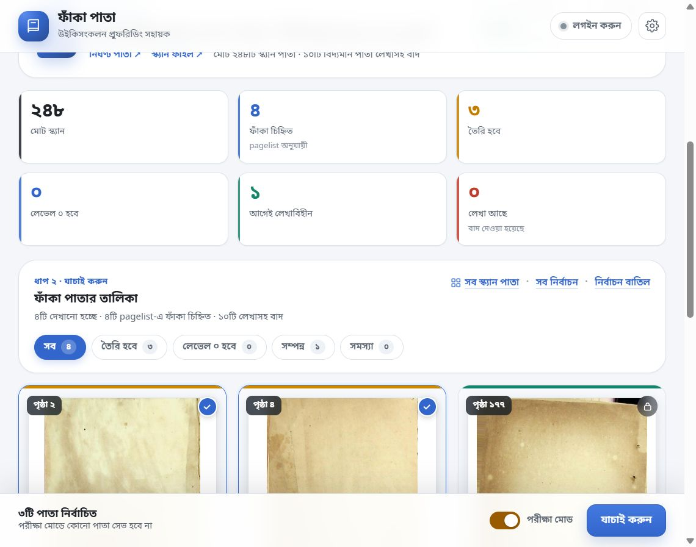
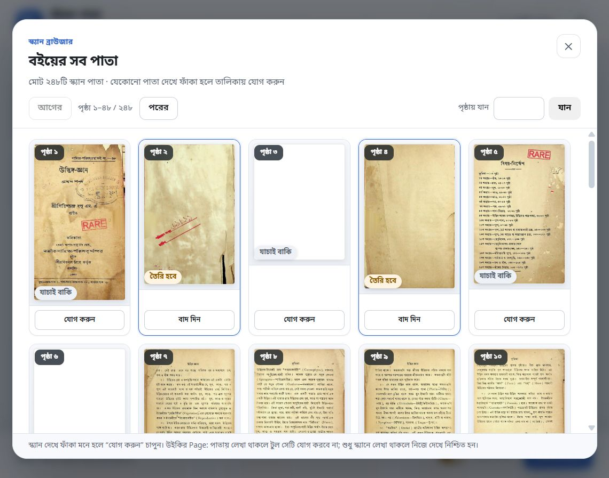

# ফাঁকা পাতা — উইকিসংকলন প্রুফরিডিং সহায়ক



উইকিসংকলনের একটি বইয়ের **ফাঁকা / খালি পাতাগুলো** এক জায়গায় দেখার, স্ক্যানের
ছবি দিয়ে যাচাই করার এবং তারপর সবগুলোকে একসাথে **“লেখাবিহীন”**
(pagequality level 0) হিসেবে চিহ্নিত করার একটি লোকাল টুল।

> এটি আপনার নিজের কম্পিউটারে চলে। কোনো সার্ভারে আপলোড করতে হয় না; শুধু
> উইকির API-তে সংযোগ করে।

## এক নজরে

| লাইভ সার্চ | পুরো বইয়ের স্ক্যান ব্রাউজার |
|:---:|:---:|
|  |  |

---

## যা করে

- বইয়ের **নির্ঘণ্ট পাতা** থেকে `<pagelist>` পড়ে ফাঁকা চিহ্নিত (`—`, `-`, `–` ইত্যাদি)
  স্ক্যান পাতা খুঁজে বের করে।
- **লাইভ সার্চ**: সার্চ বক্সে নাম লিখতে শুরু করলেই উইকিসংকলনের নির্ঘণ্ট
  namespace থেকে সরাসরি ফলাফল/সাজেশন দেখায় (prefix + full-text search)।
- বিদ্যমান `পাতা:` পাতাগুলোর ভেতরের লেখা পরীক্ষা করে **আগে থেকেই খালি** পাতাও
  তালিকায় যোগ করে।
- **শুধু ফাঁকা/খালি পাতাগুলো** ছবিসহ দেখায়; পুরো বইয়ের সব পাতা নয়।
- **সব স্ক্যান পাতা ব্রাউজার**: বইয়ের ১ থেকে শেষ পর্যন্ত সব স্ক্যান পাতা
  ছবিসহ দেখে, স্ক্যানে চোখ বুলিয়ে, তালিকায় না থাকা ফাঁকা পাতা হাতেও যোগ করা যায়।
  পৃষ্ঠা লেবেল (যেমন “ভূমিকা”, “প্রচ্ছদ”) থাকলে টুল সেটি স্বয়ংক্রিয়ভাবে
  নির্বাচন করে না — আগে যাচাই করতে বলে।
- প্রতিটি পাতার স্ক্যান বড় করে দেখার, জুম করার এবং আগের/পরের পাতায় যাওয়ার সুবিধা।
- পছন্দমতো পাতা বাদ দেওয়া/নির্বাচন করা যায়।
- একটি **পরীক্ষা মোড** (dry-run) — ডিফল্টে চালু; কিছুই সেভ হয় না।
- লগইন করে এক ক্লিকে সব নির্বাচিত পাতা `pagequality level="0"` হিসেবে সেভ।
- লেখা আছে এমন পাতাকে কখনো জোর করে খালি করে না; শুধু সতর্কবার্তা দিয়ে বাদ দেয়।
- সেভ করার ঠিক আগে প্রতিটি পাতা আবার যাচাই করে (edit conflict, redirect,
  নতুন লেখা ইত্যাদি নিরাপদে সামলায়)।

---

## যা লাগবে

- Python 3.10 বা তার নতুন সংস্করণ (Python 3.14-এ পরীক্ষিত)
- `Flask` ও `requests` (নিচের কমান্ডে ইনস্টল হবে)
- ইন্টারনেট সংযোগ (উইকি ও স্ক্যানের ছবির জন্য)

---

## চালু করা

প্রথমবার, প্রজেক্ট ফোল্ডারে টার্মিনাল খুলে:

```powershell
pip install -r requirements.txt
python app.py
```

অথবা Windows-এ `run.bat`-এ ডাবল ক্লিক করুন।

সার্ভার চালু হলে কনসোলে ঠিকানা দেখাবে, যেমন:

```
  Wikisource blank-page tool
  Open: http://127.0.0.1:8765/
  Ctrl+C to stop
```

ব্রাউজার সাধারণত নিজেই খুলে যাবে। না খুললে কনসোলে দেখানো ঠিকানাটি
ব্রাউজারে খুলুন। ৮৭৬৫ পোর্ট ব্যস্ত থাকলে টুল পরের খালি পোর্ট ব্যবহার করে —
কনসোলের ঠিকানাটাই দেখুন।

বন্ধ করতে টার্মিনালে `Ctrl+C` চাপুন।

---

## বট পাসওয়ার্ড তৈরি করা (সেভ করার জন্য)

সেভ করতে উইকিতে লগইন দরকার। নিরাপত্তার জন্য **সাধারণ অ্যাকাউন্ট পাসওয়ার্ড
ব্যবহার করবেন না** — বট পাসওয়ার্ড ব্যবহার করুন।

1. উইকিতে লগইন করা অবস্থায় <https://bn.wikisource.org/wiki/Special:BotPasswords> খুলুন।
2. একটি নাম দিন (যেমন `blankpages`) এবং প্রয়োজনীয় অনুমতি দিন:
   - **Edit existing pages** (বিদ্যমান পাতা সম্পাদনা)
   - **Create, edit, and move pages** (নতুন পাতা তৈরি)
   - `Read` সাধারণত ডিফল্টেই থাকে।
3. “Create” চাপলে একটি **লগইন নাম** (`আপনারনাম@বটনাম`) ও একটি **বট পাসওয়ার্ড**
   দেখাবে।
4. টুলের সেটিংসে:
   - **ব্যবহারকারীর নাম**: `আপনারনাম@বটনাম`
   - **বট পাসওয়ার্ড**: জেনারেট করা পাসওয়ার্ড

“এই ডিভাইসে মনে রাখুন” টিক দিলে পাসওয়ার্ডটি প্রজেক্ট ফোল্ডারের
`secrets.json`-এ **প্লেইন টেক্সটে** সংরক্ষিত হবে। না চাইলে টিক দেবেন না;
প্রতিবার নিজে লিখবেন। যেকোনো সময় Special:BotPasswords থেকে পাসওয়ার্ড
বাতিল করা যাবে।

---

## ব্যবহারের ধাপ

### ১. বই দিন

উপরের ঘরে যেকোনো একটি দিন:

- শুধু ফাইলের নাম: `আলো - জগদানন্দ রায় (১৯২৬).pdf`
- নির্ঘণ্ট পাতার নাম: `নির্ঘণ্ট:আলো - জগদানন্দ রায় (১৯২৬).pdf`
- সরাসরি লিংক: `https://bn.wikisource.org/wiki/নির্ঘণ্ট:...`

নাম লিখতে শুরু করলেই নিচে **উইকিসংকলনের নির্ঘণ্ট পাতা থেকে লাইভ ফলাফল**
আসবে। কোনো ফলাফলে ক্লিক করলে সেই বইটিই বিশ্লেষণ হবে। চাইলে পুরো নাম লিখে
“বিশ্লেষণ করুন” চাপুন, অথবা ড্রপডাউনের “সব ফলাফল ↗” থেকে উইকিসংকলনের
সাধারণ সার্চ খুলুন।

“বিশ্লেষণ করুন” চাপুন। টুল নির্ঘণ্ট ও স্ক্যান ফাইল পড়ে ফাঁকা পাতার তালিকা
তৈরি করবে।

### ১.৫. পুরো বইয়ের পাতা দেখুন (ঐচ্ছিক)

তালিকার উপরে **“সব স্ক্যান পাতা”** বাটনে ক্লিক করলে বইয়ের সব স্ক্যান পাতা
থাম্বনেইলসহ একটি ব্রাউজারে খুলবে।

- “আগের”/“পরের” দিয়ে ৪৮টি করে পাতা দেখুন, অথবা “পৃষ্ঠায় যান” দিয়ে
  নির্দিষ্ট পৃষ্ঠায় লাফ দিন।
- কোনো পাতায় ক্লিক করলে সেটি বড় করে দেখা যাবে।
- যে পাতাটি `<pagelist>`-এ ফাঁকা চিহ্নিত নয়, কিন্তু স্ক্যান দেখে ফাঁকা মনে হচ্ছে,
  সেখানে **“যোগ করুন”** চাপুন। টুল সেই পাতার বাস্তব অবস্থা দেখে তালিকায় যোগ
  করবে; উইকির `পাতা:` পাতায় লেখা থাকলে যোগ করবে না। শুধু স্ক্যানে লেখা থাকলে
  টুল তা বুঝতে পারে না — তাই চোখে দেখে নিশ্চিত হন।
- পৃষ্ঠার নির্ঘণ্ট-লেবেল যদি “ভূমিকা”, “প্রচ্ছদ” ইত্যাদি হয়, তাহলে টুল সেটি
  যোগ করলেও **সিলেক্ট করে না** — স্ক্যান দেখে নিশ্চিত হয়ে নিজে “নির্বাচন”
  চাপতে হবে।

### ২. স্ক্যান দেখে যাচাই করুন

- যেকোনো কার্ডের ছবিতে ক্লিক করুন — বড় করে দেখাবে।
- মডালে আগের/পরের পাতায় যেতে তীরচিহ্ন বা কীবোর্ডের `←`/`→` ব্যবহার করুন।
- ছবিতে ক্লিক করলে জুম হয়; `Esc` চাপলে বন্ধ হয়।
- যে পাতাগুলো আসলে ফাঁকা নয়, কার্ডের উপরের ডান দিকের চেকবক্স থেকে
  নির্বাচন বাদ দিন।
- কার্ডে “দেখা হয়েছে” চিহ্ন দেখা যায় — কোনগুলো দেখা হয়েছে তার হিসাব রাখা হয়।

### ৩. পরীক্ষা মোডে চালান

নিচের বারে **পরীক্ষা মোড** ডিফল্টে চালু থাকে। “যাচাই করুন” চাপলে টুল
প্রতিটি পাতার জন্য দেখায় কী হবে, কিন্তু **কিছুই সেভ করে না**।

### ৪. লগইন করে আসল কাজ করুন

- উপরের ডান দিকের “লগইন করুন” বা সেটিংস থেকে বট পাসওয়ার্ড দিয়ে লগইন করুন।
- **পরীক্ষা মোড বন্ধ করুন** (নিচের সুইচ)।
- “প্রুফ করুন” → “চালিয়ে যান”।
- প্রতিটি পাতা সেভ হওয়ার সাথে সাথে অগ্রগতি ও ফলাফল দেখাবে।
- কোনো পাতা বাদ পড়লে (যেমন হঠাৎ লেখা যুক্ত হয়েছে বা পুনর্নির্দেশ) সেটি
  তালিকায় কারণসহ দেখাবে; সেটি জোর করে বদলানো হবে না।

---

## কার্ডের রঙ/অবস্থার অর্থ

| অবস্থা | অর্থ | কী হবে |
|---|---|---|
| **তৈরি হবে** | `পাতা:` পাতা নেই, কিন্তু নির্ঘণ্টে ফাঁকা চিহ্নিত | নতুন করে pagequality level 0 পাতা তৈরি হবে |
| **লেভেল ০ হবে** | পাতা আছে, ভেতরে লেখা নেই, কিন্তু level 0 নয় | pagequality level 0 করা হবে |
| **আগেই লেখাবিহীন** | পাতা আছে, খালি, level 0 | কিছুই বদলানো হবে না (শুধু দেখানো হচ্ছে) |
| **লেখা আছে** | নির্ঘণ্টে ফাঁকা চিহ্নিত, কিন্তু পাতায় লেখা আছে | নিরাপত্তার জন্য বাদ; হাতে দেখুন |
| **পুনর্নির্দেশ** | শুধু redirect পাতা আছে | বদলানো হবে না |

“সমস্যা” ফিল্টারে `লেখা আছে` ও `পুনর্নির্দেশ` কার্ডগুলো দেখা যায়।
স্ক্যান ব্রাউজার থেকে হাতে যোগ করা পাতা কার্ডে **“হাতে যোগ করা”** লেখা থাকে।

---

## নিরাপত্তা

- ডিফল্ট **পরীক্ষা মোড** চালু থাকে; ভুল করে কিছু সেভ হবে না।
- লেখা আছে এমন পাতা **কখনো** স্বয়ংক্রিয়ভাবে খালি করা হয় না।
- সেভের আগে প্রতিটি পাতা আবার পড়া হয়; analysis পুরনো হলে বা পাতা বদলে গেলে
  সেটি ধরা পড়ে।
- `baserevid`, `nocreate`, `createonly` ব্যবহার করে সম্পাদনার সংঘর্ষ এড়ানো হয়।
- শুধু `পাতা:` namespace-এর নির্দিষ্ট পাতা সম্পাদনা করা হয়; নির্ঘণ্ট বা অন্য
  পাতা বদলানো হয় না।
- সার্ভার শুধু `127.0.0.1`-এ চলে; API-র POST অনুরোধে একটি র‍্যান্ডম টোকেন লাগে।
- পাসওয়ার্ড কনসোলে বা ব্রাউজারে ফেরত পাঠানো হয় না।

---

## সীমাবদ্ধতা

- **মিসিং ফাঁকা পাতা**: যে স্ক্যান পাতা `<pagelist>`-এ ফাঁকা চিহ্নিত নয় এবং
  যার কোনো খালি `পাতা:` পৃষ্ঠাও নেই, সেটি তালিকায় আসবে না — তবে
  **“সব স্ক্যান পাতা”** ব্রাউজার থেকে স্ক্যান দেখে হাতে যোগ করা যায়।
- ছবির ভিত্তিতে স্বয়ংক্রিয় “সাদা পাতা” শনাক্তকরণ নেই; যাচাই মানুষকেই করতে
  হবে (এটাই এই টুলের মূল ধারণা)। তাই কোনো পাতা “যোগ করুন” করার আগে স্ক্যানটা
  দেখে নিন।
- হাতে যোগ করা পাতার জন্য স্ক্যানে লেখা থাকলেও টুলের পক্ষে তা বোঝার উপায় নেই;
  শুধু পৃষ্ঠা-লেবেল (ভূমিকা/প্রচ্ছদ ইত্যাদি) থাকলে সতর্ক করে।
- সার্চ শুধু **নির্ঘণ্ট namespace**-এ খোঁজে; “সব ফলাফল” লিংক দিয়ে উইকিসংকলনের
  সাধারণ সার্চ করা যায়।
- একই স্ক্যানের একাধিক পাতা/পুনর্নির্দেশ মুছে ফেলে না; শুধু দেখায়।
- একসাথে একটি উইকি/বই নিয়ে কাজ করার জন্য তৈরি; অন্য উইকির বই দেখতে চাইলে
  সেই উইকিতে লগইন করতে হবে।
- `পাতা:` উপপৃষ্ঠার নাম সংখ্যায় (বাংলা বা ইংরেজি অঙ্ক) হওয়া দরকার।
- প্রথমবার ছবি লোড হতে কিছু সময় লাগতে পারে (উইকিমিডিয়ার থাম্বনেইল তৈরি হয়)।

---

## ফাইলগুলো

| ফাইল | কাজ |
|---|---|
| `app.py` | লোকাল Flask সার্ভার, লগইন/সেটিংস, বিশ্লেষণ, লাইভ সার্চ, স্ক্যান-পাতা ও সেভ API |
| `wikisource.py` | MediaWiki API ক্লায়েন্ট, pagelist পার্সার, ফাঁকা-পাতা শনাক্তকরণ, সম্পাদনা |
| `templates/index.html` | ইন্টারফেসের HTML |
| `static/style.css` | ডিজাইন |
| `static/app.js` | ব্রাউজারের লজিক (গ্যালারি, লাইভ সার্চ, স্ক্যান ব্রাউজার, ভিউয়ার, সেভ) |
| `test_wikisource.py` | ইউনিট টেস্ট |
| `requirements.txt` | Python নির্ভরতা |
| `run.bat` | Windows-এ চালু করার শর্টকাট |
| `config.json` | উইকি/ব্যবহারকারীর নাম (রানটাইমে তৈরি) |
| `secrets.json` | “মনে রাখুন” দিলে বট পাসওয়ার্ড (রানটাইমে তৈরি) |

---

## সমস্যা হলে

**লগইন ব্যর্থ**
- লগইন নাম `ব্যবহারকারী@বটনাম` কি না দেখুন; সাধারণ পাসওয়ার্ড নয়।
- বট পাসওয়ার্ডে “Edit existing pages” ও “Create, edit, and move pages”
  অনুমতি আছে কি না দেখুন।
- দুই-স্তরের যাচাই (2FA) চালু থাকলে সাধারণ পাসওয়ার্ড কাজ করবে না;
  বট পাসওয়ার্ডই ব্যবহার করুন।

**“এই বইয়ের উইকিতে লগইন করুন”**
- আপনি অন্য উইকিতে লগইন করে আছেন। সেটিংস খুলুন — এটি বইয়ের উইকিকেই
  ডিফল্ট দেখাবে; সেখানে লগইন করুন।

**“বিশ্লেষণের তথ্য পাওয়া যায়নি; আবার বিশ্লেষণ করুন”**
- সার্ভার বন্ধ/পুনরায় চালু হয়েছে। বইটি আবার বিশ্লেষণ করুন।

**পোর্ট ব্যস্ত**
- টুল পরের খালি পোর্টে চলে; কনসোলে দেখানো `Open:` ঠিকানাটি ব্যবহার করুন।

**ছবি সাদা দেখাচ্ছে**
- ফাঁকা স্ক্যান সাদাই থাকে। কার্ডে ক্লিক করে বড় করে দেখুন; পাশের দাগ,
  স্ট্যাম্প ইত্যাদি দেখা যাবে। ছবি লোড না হলে কার্ডে “স্ক্যানের ছবি পাওয়া যায়নি”
  লেখা আসবে।

**পাতার নামের অঙ্ক ভুল লাগছে**
- টুল বিদ্যমান `পাতা:` পাতাগুলো দেখে বাংলা/ইংরেজি অঙ্কের ধরন অনুমান করে।
  বইয়ে একদমই পাতা না থাকলে বাংলা উইকিতে বাংলা অঙ্ক ব্যবহার করে।

---

## টেস্ট চালানো

```powershell
python -m unittest -v test_wikisource.py
```

---

## মূল স্ক্রিপ্টের সাথে সম্পর্ক

আগের স্ক্রিপ্টটি `pagelist`-এর ফাঁকা চিহ্ন দেখে **শুধু অনুপস্থিত** পাতা
`level 0` হিসেবে তৈরি করত। এই টুল সেটাই করে, তার সাথে:

- আগে থেকেই খালি কিন্তু ভুল level-এ থাকা পাতা ঠিক করে,
- স্ক্যান দেখিয়ে মানুষকে যাচাই করার সুযোগ দেয়,
- লেখা আছে এমন পাতায় হাত দেয় না,
- এবং সেভের আগে আবার যাচাই করে।

---

*ভালো লাগলে উইকিসংকলনে আরও ফাঁকা পাতা কমাতে সাহায্য করুন।*
